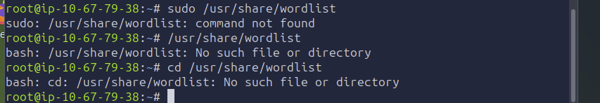
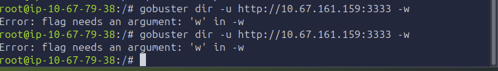
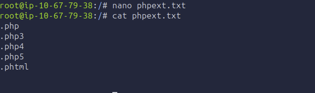
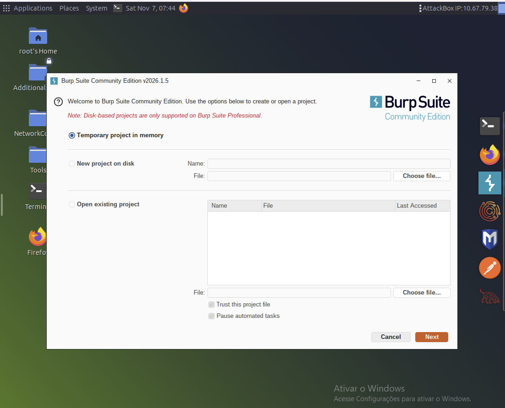
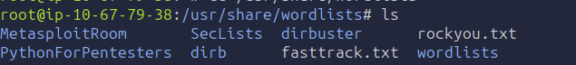
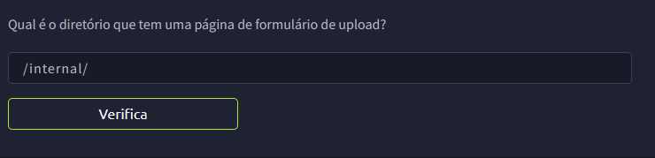
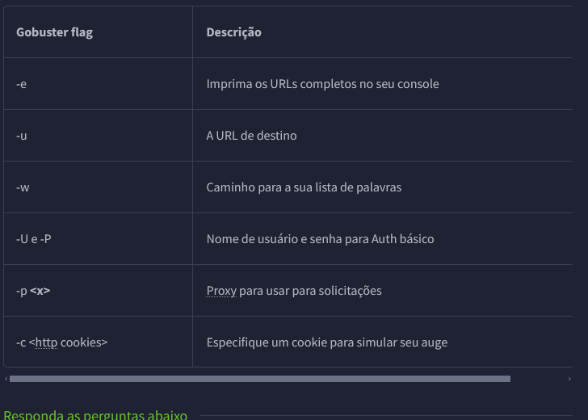
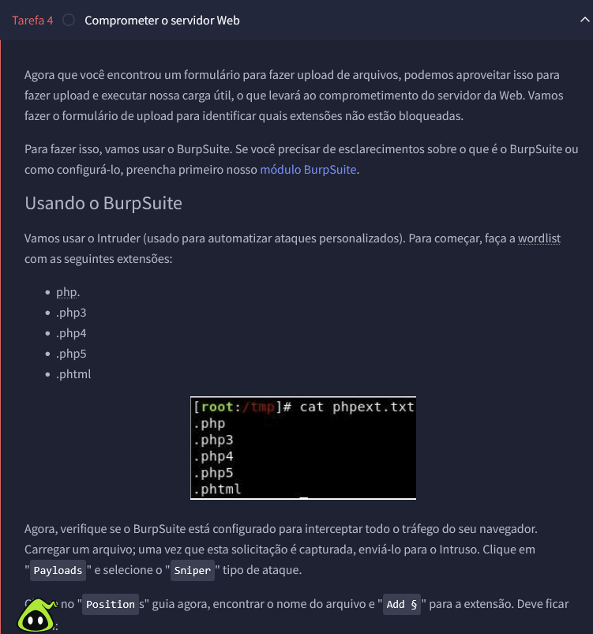
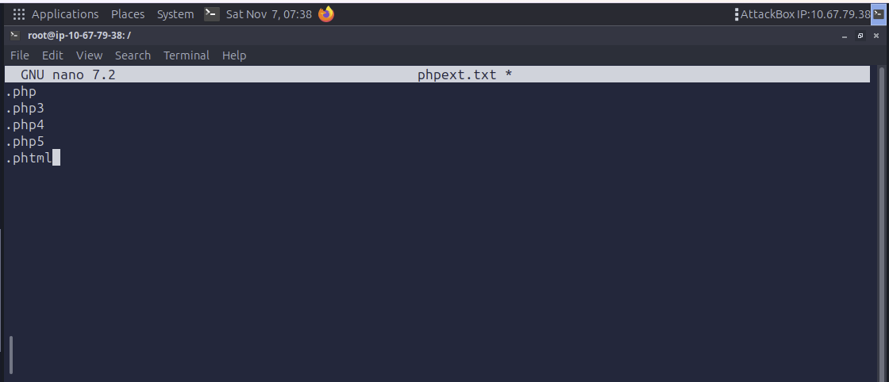

# Relatório Técnico de Teste de Intrusão: Lab Vulnversity (TryHackMe)

**Autor:** Luís Felipe Nepomuceno de Moraes  
**Alvo:** Máquina Virtual TryHackMe - Vulnversity  
**Nível:** Fácil  

---

## 1. Executive Summary
Este relatório documenta o processo técnico de auditoria e exploração da máquina virtual **Vulnversity** no TryHackMe. O laboratório simulou um ambiente web vulnerável, permitindo demonstrar falhas de arquitetura em servidores web, fraquezas em validação de inputs em formulários de upload e falhas de configuração em permissões especiais de ficheiros (SUID) em sistemas operacionais Linux baseados em Ubuntu.

---

## 2. Metodologia e Fases de Execução

### 2.1. Reconhecimento Ativo
O levantamento de portas e serviços abertos foi efetuado combinando varreduras de pacotes TCP SYN furtivos (`-sS`) com deteção agressiva de versões e serviços (`-sV` / `-A`). A porta `3333` destacou-se por hospedar um servidor HTTP Apache atípico (`Apache httpd 2.4.41`).

### 2.2. Enumeração de Diretórios Web
Utilizou-se a ferramenta **Gobuster** em conjunto com a wordlist clássica do DirBuster (`directory-list-1.0.txt`) para realizar força bruta de diretórios na porta `3333`:
* **Comando:** `gobuster dir -u http://<IP>:3333 -w /usr/share/wordlists/dirbuster/directory-list-1.0.txt`
* **Descoberta Crítica:** Identificação do diretório `/internal/`, que continha um formulário de carregamento de ficheiros (*file upload form*).

### 2.3. Contorno de Filtros (Bypass) e Execução de Código
Para injetar um *Reverse Shell*, testou-se a robustez do filtro de extensões do servidor utilizando o Burp Suite Intruder com a wordlist de extensões (`phpext.txt`).

---

## 3. Registo Fotográfico (Capturas de Ecrã da Sessão)

Abaixo encontram-se registadas todas as capturas de ecrã obtidas durante o laboratório, guardadas na pasta `docs/screenshots/`:

### Captura: input_file_0.png

### Captura: input_file_1.png

### Captura: input_file_10.png

### Captura: input_file_11.png

### Captura: input_file_12.png

### Captura: input_file_2.png

### Captura: input_file_3.png

### Captura: input_file_4.png

### Captura: input_file_5.png

### Captura: input_file_6.png

### Captura: input_file_7.png

### Captura: input_file_8.png

### Captura: input_file_9.png

